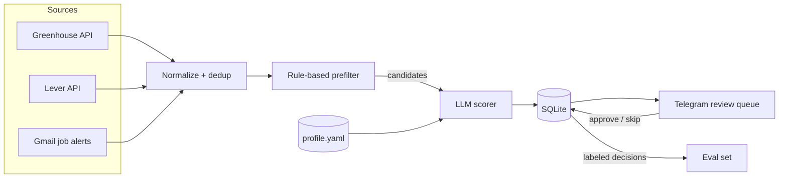

# job-search-ai

> An AI agent that finds the jobs worth applying to — and leaves the decision to you.

Auto-apply bots optimize for volume: they fire hundreds of applications and hope something sticks. **job-search-ai optimizes for fit.** It collects postings from public job-board APIs, filters them with cheap deterministic rules, scores each remaining posting against your profile with an LLM, and sends you a short daily review queue on Telegram.

**Nothing is ever submitted automatically.** That is a product decision, not a missing feature.

> **Status:** 🚧 v0.1 (MVP) in progress — see [Roadmap](#roadmap).

---

## Why

- **Mass-applying doesn't convert.** Bulk auto-apply tools report interview rates around 1 in 50 applications.
- **Bots put your account at risk.** Most auto-apply tools automate LinkedIn Easy Apply, which LinkedIn's terms prohibit and actively detects.
- **The hard part is triage, not clicking.** Reading 80 postings to find the 6 that actually fit is the real time sink. That's the part worth automating.

## How it works



| Stage | What it does | Why it matters |
|---|---|---|
| **Collect** | Pulls postings from public job-board APIs (Greenhouse, Lever) for a configured list of companies. | Structured data, no login, no scraping. |
| **Normalize & dedup** | Maps every source to one `Job` schema; dedups by content hash. | The same role posted on three boards is scored once. |
| **Prefilter** | Deterministic rules: title keywords, location/remote, seniority, blocklist. Every rejection is logged with its reason. | Cuts most of the volume before any LLM call. |
| **Score** | The LLM compares the posting with your profile and returns structured output, validated with Pydantic. | Explains *why* a job fits — and what's missing. |
| **Review** | Daily Telegram digest, sorted by score, with ✅ Apply / ⏭ Skip / 🕐 Later buttons. | Works from your phone; zero frontend. |
| **Evaluate** | Your review decisions become labeled data; the scorer is measured against your own judgment. | Turns "seems to work" into numbers. |

### Scorer output

```json
{
  "score": 78,
  "verdict": "apply",
  "matched": ["Kubernetes in production", "incident response", "Terraform"],
  "gaps": ["Go", "ArgoCD"],
  "dealbreakers": [],
  "rationale": "Strong overlap on core SRE work; Go is listed as nice-to-have, not required."
}
```

## Design principles

- **Human in the loop, always.** The agent recommends; you decide. No auto-submit, by design.
- **Recall over precision.** Missing a great job costs more than skimming a mediocre one. When the model is unsure, the verdict is `maybe` — and `maybe` still reaches the queue.
- **Never invent experience.** (v0.3) Tailored CVs may reorder and re-emphasize, but every bullet must trace back to the master CV.
- **Model-agnostic.** The LLM sits behind a thin interface, so hosted and local models (via Ollama) are compared on the same eval set.
- **Observable.** Every LLM call logs model, prompt version, tokens, latency and estimated cost.
- **Personal data stays local.** `profile.yaml`, `.env` and the database are gitignored.

## Stack

| Concern | Choice |
|---|---|
| Language / deps | Python 3.12, [uv](https://github.com/astral-sh/uv) |
| HTTP | httpx |
| Schemas & validation | Pydantic v2 |
| Storage | SQLite |
| CLI | Typer |
| Review queue | python-telegram-bot |
| LLM | Anthropic SDK · Ollama (OpenAI-compatible endpoint) |
| Tests / lint | pytest · ruff |

## Repository layout

```
job-search-ai/
├── config/
│   ├── profile.example.yaml      # copy to profile.yaml (gitignored)
│   └── sources.example.yaml      # companies to watch + prefilter rules
├── src/job_search_ai/
│   ├── collectors/
│   │   ├── base.py               # Collector interface
│   │   ├── greenhouse.py
│   │   ├── lever.py
│   │   └── gmail_alerts.py       # v0.2
│   ├── models.py                 # Job, ScoreResult, Decision
│   ├── normalize.py              # HTML → text, remote detection
│   ├── dedup.py
│   ├── prefilter.py
│   ├── scoring/
│   │   ├── llm_client.py         # provider adapters
│   │   ├── scorer.py
│   │   └── prompts/score_v1.md   # versioned prompts
│   ├── storage.py
│   ├── review/telegram_bot.py
│   └── cli.py
├── eval/
│   ├── dev.jsonl                 # labeled set used while iterating
│   ├── test.jsonl                # frozen set, only for measuring
│   ├── run_eval.py
│   └── results/
└── tests/
    └── fixtures/                 # recorded API responses
```

## Getting started

```bash
git clone https://github.com/ArthrR/job-search-ai.git
cd job-search-ai
uv sync

cp config/profile.example.yaml config/profile.yaml
cp config/sources.example.yaml config/sources.yaml
cp .env.example .env   # ANTHROPIC_API_KEY, TELEGRAM_BOT_TOKEN, TELEGRAM_CHAT_ID

uv run job-search-ai run
```

| Command | What it does |
|---|---|
| `job-search-ai collect` | Fetch, normalize, dedup and prefilter new postings |
| `job-search-ai score` | Score candidates not yet scored with the current prompt version |
| `job-search-ai review` | Send today's queue to Telegram |
| `job-search-ai run` | `collect` → `score` → `review` |
| `job-search-ai eval` | Run the scorer against the eval set and write a report |

### Configuration

`config/sources.yaml`

```yaml
greenhouse:
  - board_token: examplecorp
lever:
  - company: exampleco

prefilter:
  title_include: ["Site Reliability", "SRE", "DevOps", "Platform Engineer", "AI Engineer"]
  title_exclude: ["Intern", "Principal", "Director"]
  locations: ["Remote", "Brazil"]
  max_daily_queue: 15
```

`config/profile.yaml`

```yaml
target_roles: ["Site Reliability Engineer", "AI Engineer"]
seniority: ["mid", "senior"]
skills:
  strong: ["Kubernetes", "Terraform", "AWS", "Python", "Prometheus", "incident response"]
  working: ["Azure", "GitHub Actions"]
  learning: ["Go", "Java"]
preferences:
  work_mode: ["remote", "hybrid"]
dealbreakers: ["unpaid trial work"]
```

## Roadmap

**v0.1 — MVP**
- [ ] Greenhouse and Lever collectors
- [ ] Normalization, dedup, rule-based prefilter
- [ ] LLM scorer with structured, validated output
- [ ] SQLite storage
- [ ] Telegram review queue
- [ ] CLI + daily schedule

**v0.2 — Evals & observability**
- [ ] Labeled dev/test sets built from review decisions
- [ ] Eval runner: agreement, recall/precision on `apply`, confusion matrix
- [ ] Keyword-only baseline for comparison
- [ ] Hosted vs local (Ollama) model comparison: quality × cost × latency
- [ ] Per-call token, latency and cost logging
- [ ] Gmail job-alert collector

**v0.3 — CV tailoring**
- [ ] Structured master CV as the single source of truth
- [ ] Per-job reordering and emphasis
- [ ] Grounding check: every generated bullet must map to the master CV
- [ ] One-page PDF export

**v0.4 — Operations**
- [ ] Docker image and scheduled runs
- [ ] Metrics dashboard
- [ ] More sources (Ashby and others)

**Non-goals**
- Submitting applications automatically.
- Scraping sites whose terms forbid it.

## Results

Eval results (agreement with human labels, baseline comparison, cost per 100 postings) will be published here once v0.2 lands.

## License

MIT
